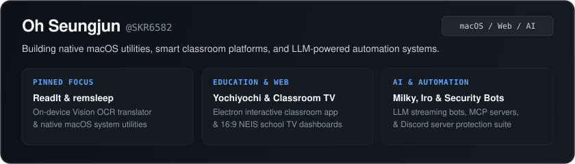

<picture>
  <source media="(prefers-color-scheme: dark)" srcset="cards/about_me.svg" />
  <source media="(prefers-color-scheme: light)" srcset="cards/about_me_light.svg" />
  
</picture>

## Pinned Highlights

| Project | Stack | Overview |
| :--- | :--- | :--- |
| **[ReadIt](https://github.com/SKR6582/ReadIt)** | `Swift` `Vision OCR` `Apple Translation` `Carbon API` | macOS 화면 캡처 및 실시간 오버레이 번역 앱. 기기 내 신경망(Vision OCR, Apple Translation) 기반으로 오프라인에서 동작하며, 플로팅 캡슐 및 노치 통합 HUD, 실시간 라이브 번역, 세로쓰기 번역, 구역 프리셋을 지원합니다. |
| **[Yochiyochi](https://github.com/SKR6582/Yochiyochi)** | `TypeScript` `Electron` `React` `Vite` | 스마트 교실 환경용 일본어(히라가나·가타카나) 수업 및 학급 관리 데스크톱 애플리케이션. 중복 방지 문자 추첨, 무선 프리젠터 단축키, 획 단위 객체 지우개 화이트보드, 결석자 배제 번호 추첨 기능을 포함합니다. |
| **[Classroom_TV_Lite](https://github.com/SKR6582/Classroom_TV_Lite)** | `Python` `JavaScript` `Termux` `NEIS API` | Android 공기계(Termux), Raspberry Pi, PC에서 구동하여 교실 TV에 16:9로 미러링하는 학급 대시보드. 초 단위 시계, 현재 교시 및 남은 시간, NEIS 시간표·급식 로컬 캐시, 웹 설정 및 원클릭 버전 업데이트를 제공합니다. |

---

## Core Projects by Domain

### 1. macOS Native & Cross-Platform Applications

| Repository | Tech Stack | Description |
| :--- | :--- | :--- |
| **[ReadIt](https://github.com/SKR6582/ReadIt)** | `Swift` `SwiftUI` `Vision` | 화면 텍스트 인식 후 원문 위치에 번역을 덮어쓰는 macOS 네이티브 번역 유틸리티 |
| **[remsleep](https://github.com/SKR6582/remsleep)** | `Swift` `SwiftUI` `IOKit` `Touch ID` | 클램쉘(덮개 닫힘) 상태에서도 백그라운드 프로세스 유지를 위해 절전을 제어하고 내장 디스플레이 밝기를 자동 조절하는 macOS 메뉴 막대 앱 |
| **[Yochiyochi](https://github.com/SKR6582/Yochiyochi)** | `Electron` `React` `TypeScript` | 일본어 문자 학습, 스마트 화이트보드, 번호 뽑기를 통합한 교실용 데스크톱 앱 |
| **[LingoLens](https://github.com/SKR6582/LingoLens)** | `Swift` `C++` `Vision OCR` | 실시간 화면 캡처 및 OCR 기반 macOS 번역 프로토타입 |
| **[ScreenDimmer](https://github.com/SKR6582/ScreenDimmer)** | `Swift` | macOS 디스플레이 밝기 및 화면 오버레이 제어 유틸리티 |

### 2. Smart Classroom & Web Platforms

| Repository | Tech Stack | Description |
| :--- | :--- | :--- |
| **[Classroom_TV_Lite](https://github.com/SKR6582/Classroom_TV_Lite)** | `Python` `HTML/CSS` `JS` | Termux 및 경량 서버 기반 16:9 교실 TV 시간표·급식·공지 대시보드 |
| **[classroom_v4](https://github.com/SKR6582/classroom_v4)** | `Next.js 15` `TypeScript` | 기능 단위 모듈 구조와 Glass UI를 적용한 교실 TV 및 관리자 대시보드 |
| **[Classroom_tv-V2](https://github.com/SKR6582/Classroom_tv-V2)** | `Next.js` `React` `TypeScript` | 학교 디지털 사이니지 및 교실 디스플레이 연동 웹 플랫폼 |
| **[ska_manager](https://github.com/SKR6582/ska_manager)** | `Next.js` `React` `TypeScript` | 독서실 및 스터디룸 좌석 현황 관리·예약 웹 시스템 |

### 3. AI Agents, LLM & Discord Ecosystem

| Repository | Tech Stack | Description |
| :--- | :--- | :--- |
| **[Milky](https://github.com/SKR6582/Milky)** | `TypeScript` `discord.js v14` `PostgreSQL` | OpenAI 스트리밍 응답과 PostgreSQL 저장소 분리를 적용한 Discord 캐릭터 챗봇 |
| **[DiscordBot-Iro](https://github.com/SKR6582/DiscordBot-Iro)** | `Python` `Py-cord` `LLM API` | 한국어 대화형 AI 디스코드 챗봇 시스템 (`Iro_2025ver` 후속 버전 포함) |
| **[Hana-Intelligence](https://github.com/SKR6582/Hana-Intelligence)** | `Python` `OpenAI API` | 다중 기능 모듈을 결합한 통합 AI 챗봇 플랫폼 |
| **[discord_protect](https://github.com/SKR6582/discord_protect)** | `Python` `Py-cord` | 서버 이상 징후 탐지 및 보안 방어용 디스코드 봇 |
| **[Orbit](https://github.com/SKR6582/Orbit)** | `Python` `Py-cord` | 디스코드 서버 백업, 복구 및 상태 보존 매니저 |
| **[Vanguard](https://github.com/SKR6582/Vanguard)** | `Python` `Discord API` | 디스코드 서버 운영 개입 및 사용자 신고 처리 자동화 시스템 |
| **[Persona_Diary](https://github.com/SKR6582/Persona_Diary)** | `Electron` `JavaScript` `Python` | AI 기반 감정 기록 및 캘린더 다이어리 애플리케이션 |
| **[pycord_MCP](https://github.com/SKR6582/pycord_MCP)** | `Python` `MCP` | Discord 봇 개발 및 제어를 위한 Model Context Protocol 서버 실험 프로젝트 |

### 4. Computer Vision, ML & Developer Tools

| Repository | Tech Stack | Description |
| :--- | :--- | :--- |
| **[Virtual_Keyboard](https://github.com/SKR6582/Virtual_Keyboard)** | `Python` `Computer Vision` `ML` | 카메라와 기계학습을 활용한 비접촉 가상 키보드 프로젝트 |
| **[keychain_cli](https://github.com/SKR6582/keychain_cli)** | `Python` | 소스코드 내 민감 키 및 보안 위협 요소를 자동 탐지하는 CLI 스캐너 |
| **[mass-produced-shorts-skipper](https://github.com/SKR6582/mass-produced-shorts-skipper)** | `Python` `JavaScript` `XGBoost` | 기계학습 분류 모델을 활용해 양산형 숏폼 영상을 자동 필터링·스킵하는 확장 도구 |
| **[prompt-depth-analysis](https://github.com/SKR6582/prompt-depth-analysis)** | `Python` | 프롬프트 품질에 따른 LLM 출력 깊이 변화 분석 연구 저장소 |

---

## Tech Stack

| Category | Technologies |
| :--- | :--- |
| **Languages** | Swift, TypeScript, JavaScript, Python, C++, C, Dart, SQL |
| **Desktop & Mobile** | SwiftUI, AppKit, Apple Vision / Translation, Electron, Flutter |
| **Web & Backend** | Next.js, React, Vite, Node.js, FastAPI, PostgreSQL, MySQL |
| **AI & Automation** | OpenAI API, Model Context Protocol (MCP), discord.js, Py-cord, XGBoost |
| **Environment & DevOps** | macOS, Linux (Termux / Ubuntu), Docker, Git, GitHub Actions |

  

---

## Activity & Contributions

<picture>
  <source media="(prefers-color-scheme: dark)" srcset="https://raw.githubusercontent.com/SKR6582/SKR6582/output/github-contribution-grid-snake-dark.svg" />
  <source media="(prefers-color-scheme: light)" srcset="https://raw.githubusercontent.com/SKR6582/SKR6582/output/github-contribution-grid-snake.svg" />
  
</picture>

---

## Links

- **Portfolio**: [https://skr6582.netlify.app/](https://skr6582.netlify.app/)
- **All Public & Private Repository Index**: [github_repositories.md](./github_repositories.md)
